# Lefa

[](https://github.com/Ref-DevSa/lefa/actions/workflows/ci.yml)

> **Every policy. One vault. Claim-ready for the people you love.**
> Lefa keeps every funeral and life policy a family pays for in one secure vault, so when someone dies, the cover actually reaches the people they left behind.

South Africans hold **17 million funeral policies**, yet roughly **R88.5 billion** in financial assets sits unclaimed and **8.7 million risk policies lapsed in 2025**. Families often don't know which policies a loved one had, or how to claim them in the 7 days they have to arrange a funeral. Lefa fixes that *before* it's too late:

1. **Record** every policy across every insurer, and see your true active cover.
2. **Prepare** claim documents in a private vault.
3. **Nominate** someone you trust. They see nothing until it's needed.
4. **Unlock** when the family's broker verifies the death certificate.
5. **Claim and track** every payout in one shared timeline.

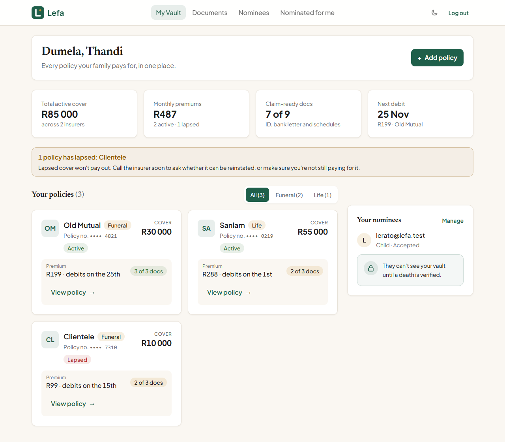

## 🔗 Links

| Resource | Link |
|---|---|
| **Live app** | **[lefa-nine.vercel.app](https://lefa-nine.vercel.app)** |
| Live API (health check) | [lefa-api.onrender.com/api/health](https://lefa-api.onrender.com/api/health) |
| Loom pitch + demo | _TODO_ |
| Stitch designs | [Lefa on Stitch](https://stitch.google.com/projects/15454914779053559520) · [exports](docs/designs/README.md) |
| Business case | [BUSINESS.md](BUSINESS.md) |
| Product requirements | [docs/PRD.md](docs/PRD.md) |
| How it works (plain language) | [docs/HOW_IT_WORKS.md](docs/HOW_IT_WORKS.md) |
| Implementation plan | [IMPLEMENTATION_PLAN.md](IMPLEMENTATION_PLAN.md) |
| Demo script / submission checklist | [docs/LOOM_SCRIPT.md](docs/LOOM_SCRIPT.md) · [docs/SUBMISSION.md](docs/SUBMISSION.md) |
| Author's portfolio | [refilwe-segoe.vercel.app](https://refilwe-segoe.vercel.app) |

## 🔑 Test logins

All demo accounts use the password **`LefaDemo2026!`**.

| Role | Email | What you'll see |
|---|---|---|
| Member (policyholder) | `thandi@lefa.test` | My Vault: 3 policies, **R85 000** active cover, 1 lapsed, 7 of 9 claim documents ready, Lerato as nominee |
| Member (nominee, locked) | `lerato@lefa.test` | Thandi's accepted nominee: sees **only her name** until a death is verified |
| Member (nominee, unlocked) | `sipho@lefa.test` | Gogo Mmabatho's vault, unlocked after a verified death (AVBOB **paid**, Assupol submitted); Jabulani's death report **pending** |
| Broker | `broker@lefa.test` | Looks after all demo families; **1 death report to verify** (Jabulani), claims pipeline |
| Admin | `admin@lefa.test` | Broker views with access to every family |

**Two-minute demo:** log in as the **broker**, open Jabulani's report and **Verify & unlock vault**. Then log in as **Sipho**: Jabulani's vault is now open with a Sanlam claim to track.

> **Demo environment.** These passwords are public, so please don't enter real personal or policy details. The API runs on Render's free plan and sleeps after 15 minutes idle: the first request can take up to a minute (the site pings it on load to wake it).

## ✅ Features (PRD Must-haves)

| | Feature | What it does |
|---|---|---|
| M1 | **Accounts and roles** | Sign up / log in as **member**; brokers and admins are assigned by an admin, never self-chosen. Each role lands on its own home; wrong-role pages show 403. |
| M2 | **Policy vault** | Add, edit and remove policies; totals in exact cents (**active** cover only), next debit date, lapse warnings, masked policy numbers. |
| M3 | **Nominees, locked** | Invite up to 3 trusted people (with a WhatsApp share message). Accepted nominees see **nothing** but the owner's name until a death is verified. |
| M4 | **Claim-ready documents** | Upload PDF/JPG/PNG ≤ 5 MB to a private bucket; real file type checked on the server; 60-second view links; per-policy claim checklist. |
| M5 | **Death → verification → claims** | A nominee reports a death with the certificate; the family's broker verifies it in one step that **unlocks the vault and opens a claim per policy**; claims move through a logged pipeline both sides can see. |

## 📸 Screenshots

| | |
|---|---|
| 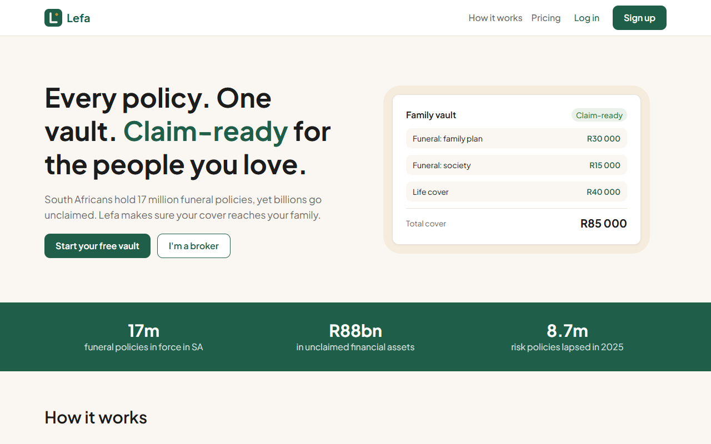 **Landing** | 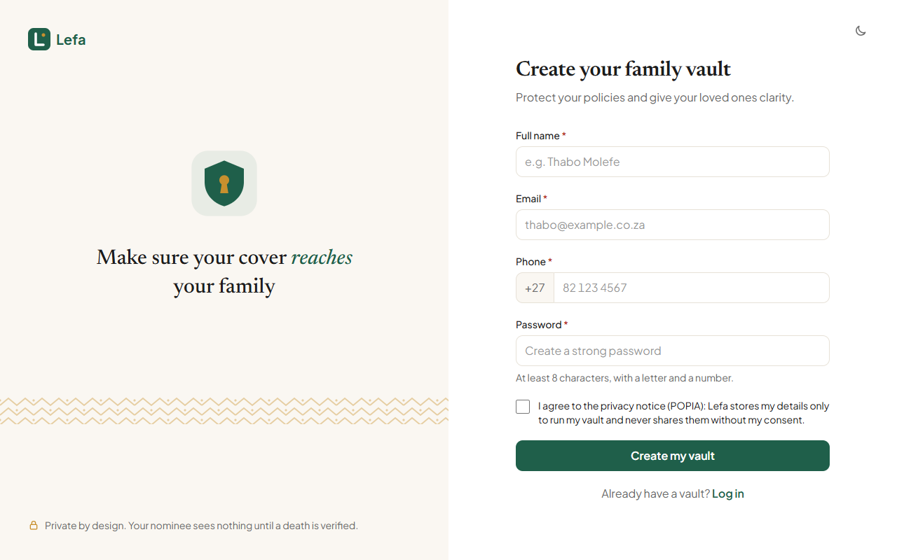 **Sign up** |
| 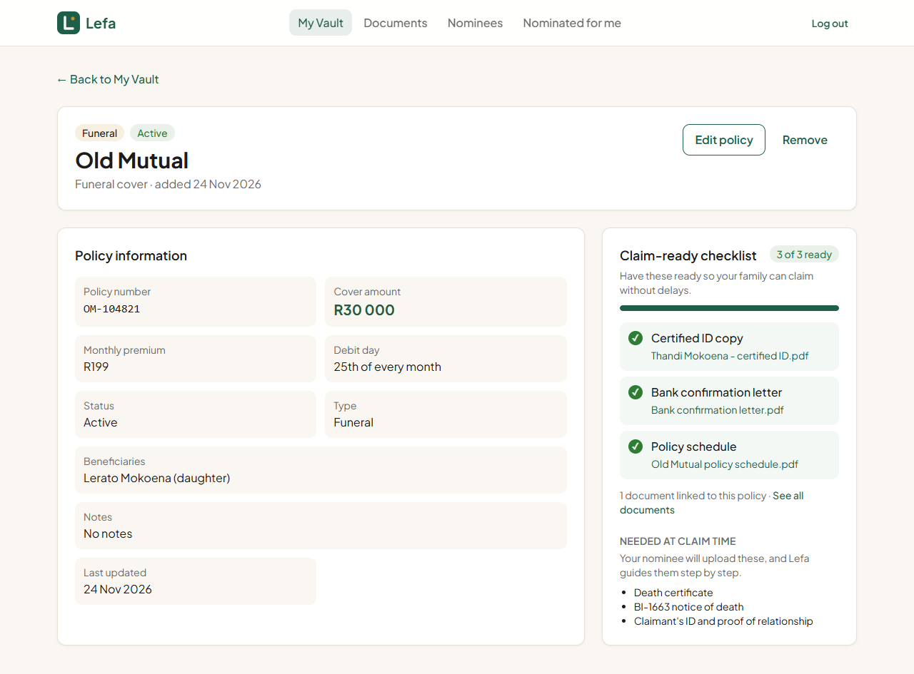 **Policy detail + claim checklist** | 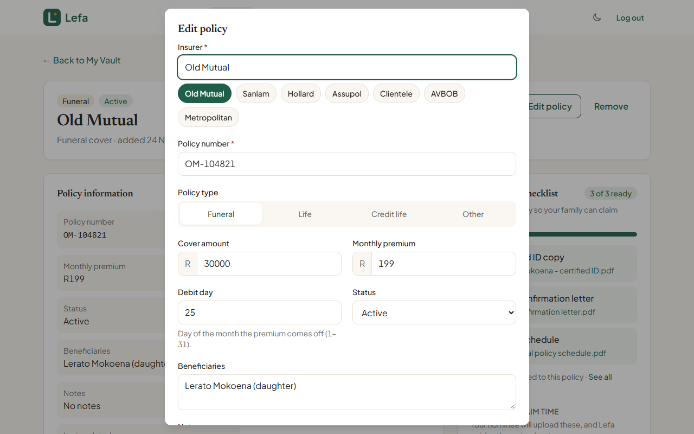 **Add / edit policy** |
| 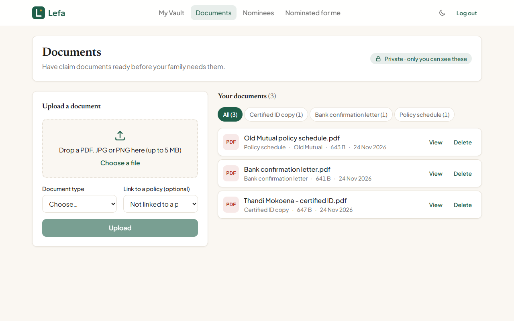 **Documents** | 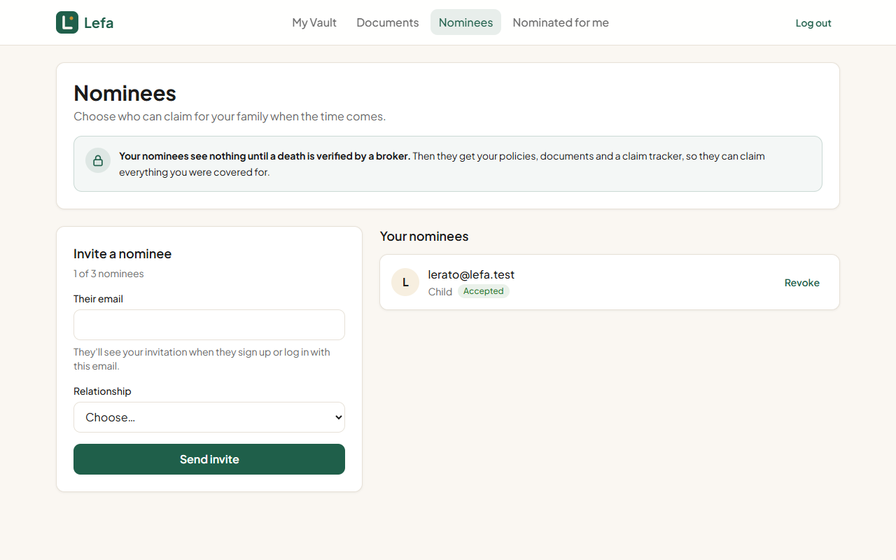 **Nominees** |
| 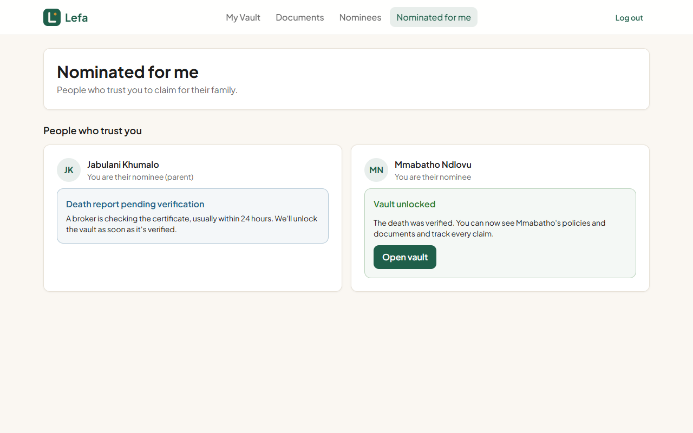 **Nominated for me** | 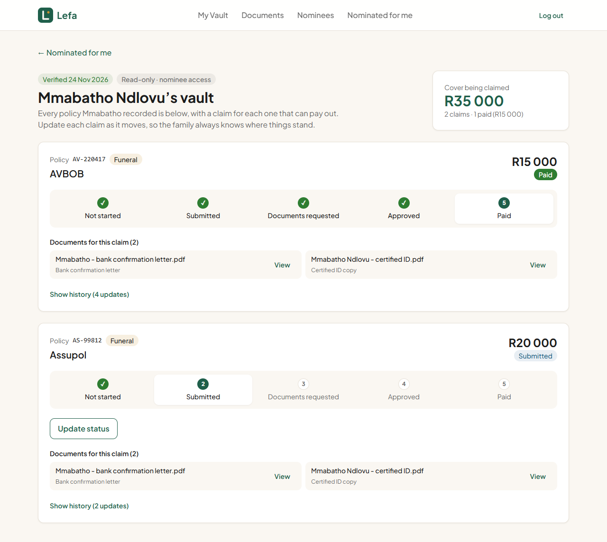 **Unlocked vault + claims** |
| 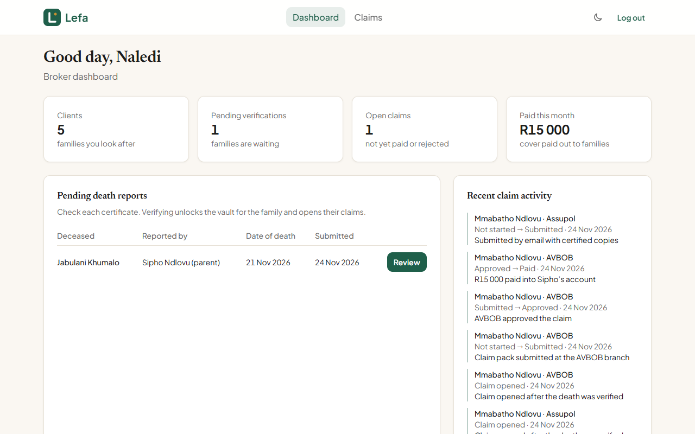 **Broker dashboard** | 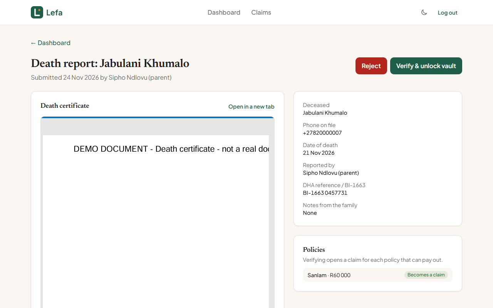 **Verify a death report** |
| 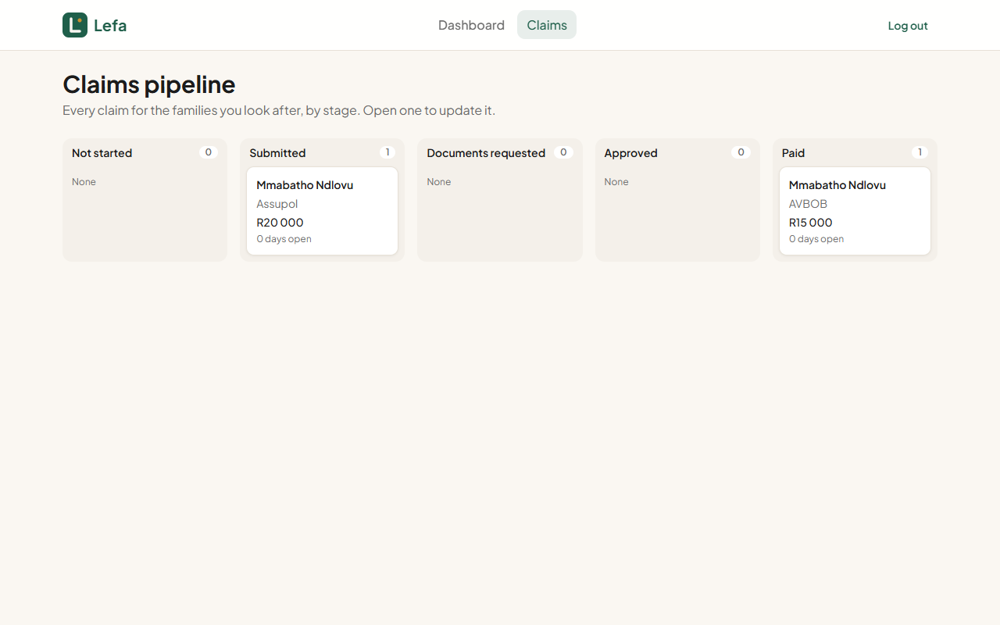 **Claims pipeline** | 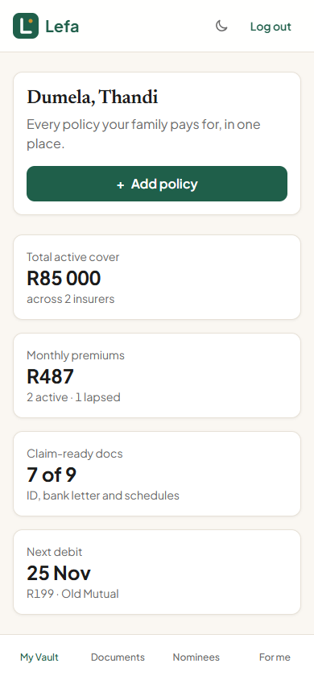 **Mobile** |

## 🏗️ Architecture

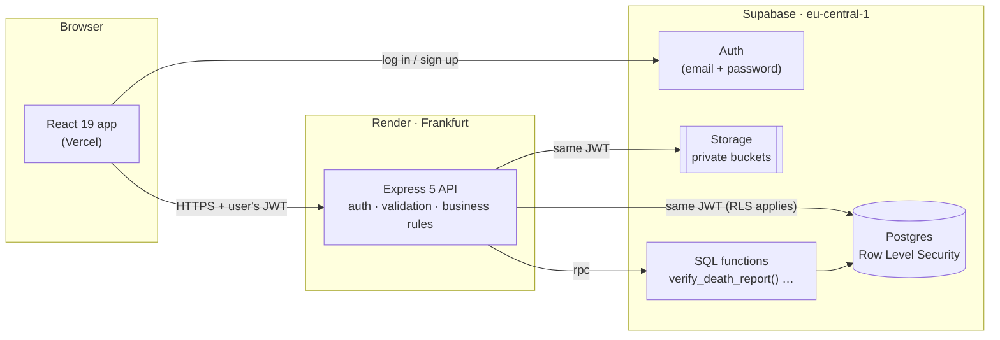

- **The browser never holds a master key.** It logs in with Supabase Auth and sends the user's token to the API.
- **The API acts as the user.** It forwards that token to Supabase, so **Row Level Security decides every row** the request can see or change. The service-role key is used only by the local seed script.
- **The security rules live in the database**, so a bug in the website or API can't leak another family's data:

| Who | Can see |
|---|---|
| Member | Their own profile, policies, documents and nominees |
| Accepted nominee, **before** a verified death | Only the owner's name (via `my_nominations()`) |
| Accepted nominee, **after** a verified death | The owner's policies, documents, claims and timeline (read-only) |
| Broker | Only the families they're linked to: reports, vaults, claims |
| Admin | Everything (support) |

- **One step unlocks a vault.** `verify_death_report()` runs in a single transaction: it marks the report verified and creates a claim for every active or paid-up policy. Only the family's broker or an admin can call it. Afterwards the deceased's vault is **frozen**.
- **Every claim change is logged** (`claim_events`: who, from, to, note) through `update_claim_status()`.
- Plain-language walk-through of every piece: **[docs/HOW_IT_WORKS.md](docs/HOW_IT_WORKS.md)**.

## 🧱 Tech stack

| Layer | Technology |
|---|---|
| Frontend | React 19, Vite 8, Tailwind CSS 4, React Router 7, TanStack Query 5 |
| API | Node.js 22+, Express 5, zod 4, multer |
| Database | Supabase: PostgreSQL, Auth, Row Level Security, Storage, SQL functions |
| Tests | Jest, React Testing Library, Supertest, **pgTAP** (database security) |
| CI / hosting | GitHub Actions · Vercel (client) · Render (API) · Supabase Cloud |

## 📁 Project structure

```text
client/                  React app (Vite)
  src/app/               routes, providers (auth, data, API)
  src/features/          auth, vault, documents, nominees, unlock, broker, landing, system
  src/components/        UI kit (Button, Input, Card, Modal, Toast, …) and layout
  src/lib/               API client, formatting (R85 000, 22 Nov 2026), helpers
server/                  Express API
  src/routes/            policies, vault, documents, nominees, death-reports, vaults, broker
  src/middleware/        login check (requireAuth / requireRole), error handler
  src/schemas/           zod input rules
  scripts/seed.js        demo data (local only; uses the service-role key)
supabase/
  migrations/            001–006: tables, RLS, storage, functions
  tests/                 pgTAP security tests (one file per migration)
docs/                    PRD, HOW_IT_WORKS, designs, screenshots
```

## 💻 Run it locally

**You need:** Node.js 22.9+ and npm, Git, and a Supabase project.

```bash
git clone https://github.com/Ref-DevSa/lefa.git
cd lefa
npm ci
```

**1. Settings.** Copy the templates and fill in your Supabase URL and **anon** key (Project Settings → API Keys):

```bash
cp client/.env.example client/.env.local   # VITE_SUPABASE_URL, VITE_SUPABASE_ANON_KEY
cp server/.env.example server/.env         # SUPABASE_URL, SUPABASE_ANON_KEY
```

**2. Database.** Link your project, apply the migrations and run the security tests:

```bash
npx supabase login
npm run db:link -- --project-ref <your-project-ref>
npm run db:push     # applies supabase/migrations
npm run db:test     # runs the pgTAP tests (in a transaction, rolled back)
```

In Supabase → Authentication → Sign In / Providers → Email, turn **Confirm email** off for local testing.

**3. Demo data (optional).** Copy `server/.env.seed.example` to `server/.env.seed`, add a **secret / service_role** key (local only, never commit it), then:

```bash
npm run db:seed        # 5 demo logins + the stories above (safe to re-run)
npm run db:reset-demo  # put Jabulani's death report back to pending (re-run the demo)
```

**4. Run.**

```bash
npm run dev         # API on :3001, website on :5173 (Vite forwards /api)
```

## 🧪 Tests

| Layer | Tool | Count | Run |
|---|---|---|---|
| Database security | pgTAP | **115** | `npm run db:test` |
| API | Jest + Supertest | **103** | `npm test -w server` |
| Website | Jest + React Testing Library | **197** | `npm test -w client` |

- **Database:** each migration has a test file that plays the roles: an owner, a nominee before and after a death, a stranger, the family's broker, another broker and an anonymous visitor. It checks what each can and can't see or change. The key test is *"an accepted nominee sees 0 policies until a death is verified"*.
- **API:** every route runs against an in-memory fake of Supabase that mirrors the RLS rules. Tests cover logins (401), roles (403), validation (400), duplicates (409), uploads (real file type, 5 MB) and the full report → verify → claim flow.
- **Website:** tests click through the app like a person would: forms, guards, empty and error states, and every main journey.
- `npm run check` runs lint, typecheck, all tests and the build. **GitHub Actions** runs the same on every pull request.

## 🚀 Deployment

| Part | Host | Notes |
|---|---|---|
| Website | Vercel (root `client/`) | `client/vercel.json`: SPA rewrites + security headers. Env: `VITE_SUPABASE_URL`, `VITE_SUPABASE_ANON_KEY`, `VITE_API_URL` |
| API | Render (`render.yaml` blueprint) | Free plan, Frankfurt. Env: `SUPABASE_URL`, `SUPABASE_ANON_KEY`, `CORS_ORIGIN` (the Vercel URL) |
| Database | Supabase Cloud | `npm run db:push` applies migrations |

Every merge to `main` redeploys the website and API automatically.

## 🔌 API

All routes return errors as `{ "error": { "code", "message", "fields?" } }`.

| Method | Path | Who | Purpose |
|---|---|---|---|
| GET | `/api/health` | anyone | Health check |
| GET | `/api/me` | signed in | Profile + role |
| GET / POST | `/api/policies` | member | List / add own policies |
| GET / PATCH / DELETE | `/api/policies/:id` | member | One policy |
| GET | `/api/vault/summary` | member | Totals (active cover, premiums) |
| GET / POST | `/api/documents` | member | List / upload (multipart, ≤ 5 MB) |
| GET | `/api/documents/:id/url` | member | 60-second view link |
| DELETE | `/api/documents/:id` | member | Delete record + file |
| GET / POST | `/api/nominees` | member | My nominees / invite |
| PATCH | `/api/nominees/:id` | owner or nominee | `accept` · `decline` · `revoke` · `reinvite` |
| GET | `/api/nominations` | member | Where I'm the nominee (+ vault state) |
| POST | `/api/death-reports` | accepted nominee | Report a death with the certificate |
| GET | `/api/vaults/:ownerId` | unlocked nominee, broker | Read-only vault + claims (403 until verified) |
| GET | `/api/vaults/:ownerId/documents/:id/url` | unlocked nominee, broker | 60-second view link |
| PATCH | `/api/claims/:id` | unlocked nominee, broker | New status + note (logged) |
| GET | `/api/broker/overview` | broker, admin | KPIs + recent activity |
| GET | `/api/broker/reports[/:id]` | broker, admin | Report queue / details + certificate link |
| POST | `/api/broker/reports/:id/verify` · `/reject` | broker, admin | Verify (unlock + claims) / reject with reason |
| GET | `/api/broker/claims[/:id/events]` | broker, admin | Pipeline / claim timeline |

## ⚠️ Known issues and limitations

- **No emails yet.** "Confirm email" and "Forgot password" need an email provider (custom SMTP), which is on the go-live list. Nominee invitations are shared via a WhatsApp message instead.
- **Brokers are linked to families by an admin in the database.** There's no admin screen for this yet (PRD Should-have S3).
- **Plans aren't enforced.** Everyone gets the Family Plus limits (3 nominees); payments aren't built.
- **No undo for a verification.** A wrongly verified death needs an admin fix in the database; the confirmation dialog exists to prevent this.
- **The claim stepper ticks earlier stages as "passed"** even if a claim skipped one (e.g. Submitted → Approved). The timeline shows the exact history.
- **Free hosting:** the API sleeps after 15 minutes idle (first request can take up to a minute).
- **Bundle size:** the main script is about 190 kB gzipped (Supabase client included); splitting it per page is planned.
- **Demo data is public:** the test passwords are in this README, so the project must not hold real personal data.

## 🗺️ Next

- Email sending (confirmations, password reset, nominee invitations)
- Admin screen to link brokers to families
- Premium-due reminders before debit day (PRD S1) and an insurer directory with claim contacts (S2)
- Claim-pack PDF for the family to take to the insurer (S4)
- POPIA review, separate production project, paid API plan

## 👤 Author

**Refilwe Segoe** · [Portfolio](https://refilwe-segoe.vercel.app) · [GitHub @Ref-DevSa](https://github.com/Ref-DevSa)
